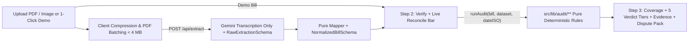

# ClaimKavach

## 1. Project Title & Overview

**ClaimKavach** is an educational hospital-bill and insurance-deduction auditor built for Indian families at the discharge desk. It pairs AI document transcription with a pure, deterministic TypeScript rules engine so families can inspect line items, reconcile totals, see exactly what could and could not be checked, and prepare polite written queries before paying.

> **Educational Disclaimer:** ClaimKavach is an educational verification tool. It is **not** legal or medical advice. Always consult a qualified professional before making financial, medical, or claim decisions.

---

## 2. Problem Statement

Indian families frequently face opaque ₹2–5 lakh hospital discharge bills filled with unitemized pharmacy/consumable lump sums, repeated diagnostic entries, arithmetic discrepancies, and vague insurance/TPA deductions (such as unexplained *"Reasonable & Customary"* cuts). At a stressful discharge counter—often on a mobile phone—families rarely have time or tooling to check line-by-line math or distinguish legitimate exclusions from questionable charges without risking AI hallucinations.

---

## 3. Proposed Solution

**"AI Reads, Deterministic Rules Judge."**

1. **AI Transcription Only (`/api/extract`)**: Google Gemini reads uploaded PDF/image bills into strict, Zod-validated JSON without judging prices or making legal claims.
2. **Human-in-the-Loop Verify Step**: Families review extracted lines against a live **Reconcile Bar** (`Stated Bill Total` vs `Computed Sum of Lines`), edit any OCR mistake, and toggle `"I checked this"` before running the audit.
3. **100% Pure Deterministic Rules Engine (`src/lib/audit/**`)**: Runs locally in the browser using integer-paise arithmetic and calendar-valid ISO `YYYY-MM-DD` dates.
4. **Honest `NOT_CHECKED` Transparency**: Rather than guessing or fabricating numbers, any category without a verified official document in `docs/sources/raw/` explicitly emits `NOT_CHECKED` with a neutral, data-derived reason, and the 5 verdict tiers are never collapsed into an inflated single "Total Savings" figure.

---

## 4. Key Features

- **1-Click Synthetic Demo Strip**: Three pre-built `SYNTHETIC` scenarios (`Stent Overcharge + Duplicate + Lump Sum`, `TPA / Insurer Deduction Review`, `Clean Bill`) allow testing the complete workflow in seconds without uploading a file.
- **Client-Side Compression & PDF Batching**: Accepts PDF, JPEG, PNG, and WebP files; renders PDF pages locally via `pdfjs-dist` and compresses/packs batches strictly under 4 MB per `/api/extract` request.
- **Verify Step with Live Reconcile Bar**: Mobile-first cards + desktop table with live `formatINR` (`₹1,25,000.00`) reconciliation, editable line items, and TPA deduction rows.
- **5-Tier Deterministic Rules Engine**:
  - `CONFIRMED` — Pure arithmetic mismatches or ceiling overcharges backed by `verified: true` reference records.
  - `LIKELY` — Duplicate line items or ceiling overcharges backed by `verified: false` records (`Unverified Data` badge).
  - `NEEDS_REVIEW` — Bulk pharmacy/consumables lump sums or vague TPA deductions (e.g., `"Reasonable & Customary"`).
  - `VALID_EXCLUSION` — Deductions matching loaded standard non-payable exclusions.
  - `NOT_CHECKED` — Transparent reason whenever official reference data is absent or specifications do not match cleanly.
- **Expandable Evidence Panels**: Shows exact arithmetic formulas or reference order provenance (`sourceTitle`, `instrumentNumber`, `instrumentDate`, `provenancePageRow`).
- **Polite Dispute Draft Pack**: 4 copy-ready templates (`Hospital Billing Query`, `Insurer Grievance Officer`, `Bima Bharosa / Grievance Portal`, `Insurance Ombudsman`) with `[FILL IN: ...]` placeholders and a mandatory verification checklist.
- **Accessibility & Polish**: English / Hindi (`EN`/`HI`) toggle with verified key parity, Web Speech API **"Listen to Report Summary"** (`localService` voice preference + online voice disclosure), `/sources` provenance transparency page, and A4 print stylesheet (`Print / Save as PDF`).

---

## 5. Technologies Used

- **Framework & UI**: Next.js 16 (`16.4.6`), React 19, TypeScript 5, Tailwind CSS v4 (`@tailwindcss/postcss`)
- **Validation & Parsing**: Zod v4 (`zod`), `pdfjs-dist` (client-side PDF rendering)
- **AI Transcription**: `@google/generative-ai` (Google Gemini)
- **Testing & Quality**: Vitest (`vitest`, `@testing-library/react`, `jsdom`), ESLint 9 (`eslint-config-next`) with custom purity boundary rules
- **Hosting Target**: Vercel
- **AI Development Tools Disclosure**: Built with AI coding assistance using **Antigravity** and **Gemini**.

---

## 6. Installation & Setup

### Prerequisites
- Node.js `>= 20`
- `pnpm` (`12.x`)

### Setup
```bash
pnpm install
cp .env.example .env.local
```

Configure `.env.local` using `.env.example` (never commit `.env*` files):
- `GEMINI_API_KEY`: Your Google Gemini API key (required for live `/api/extract` calls).
- `GEMINI_MODEL`: Exact Gemini model name (for example `gemini-2.0-flash`; `/api/extract` fails cleanly with HTTP `503` if missing rather than falling back to a hardcoded model).
- `EXTRACT_MOCK`: Optional `true` for local development without a Gemini API key (**automatically ignored when `NODE_ENV === 'production'`**).

---

## 7. How to Run (Mock vs. Real)

### Local Mock Mode (No API Key Needed)
Set `EXTRACT_MOCK=true` in `.env.local` (works only when `NODE_ENV !== 'production'`):
```bash
pnpm dev
```
You can also test all 3 synthetic demo bills directly on `/` with zero backend configuration.

### Local Real Gemini Mode
Set `GEMINI_API_KEY` and `GEMINI_MODEL` in `.env.local` (and omit or set `EXTRACT_MOCK=false`):
```bash
pnpm dev
```

### Verification Commands
```bash
pnpm lint       # ESLint + src/lib/audit/** purity boundary checks
pnpm typecheck  # TypeScript strict check (tsc --noEmit)
pnpm test       # Full Vitest suite
pnpm build      # Production Next.js build (next build --webpack)
pnpm smoke http://127.0.0.1:3000  # Live deployment smoke test
```

---

## 8. Project Architecture & Workflow



See [docs/ARCHITECTURE.md](docs/ARCHITECTURE.md) for strict boundary rules and provenance details.

---

## 9. Privacy Model

- **We store nothing**: Bill data, extracted lines, and audit reports live solely in React component state for the active browser tab (no database, no `localStorage`, no `sessionStorage`).
- **Gemini text extraction only**: Uploaded bill images are sent over HTTPS to `/api/extract` (`Cache-Control: no-store`) and forwarded to Google Gemini solely to transcribe text and numbers. Request bodies, base64 images, patient names, and API keys are never logged.
- **Local audit execution**: The deterministic rules engine (`src/lib/audit/**`) runs locally in the user's browser.
- **Audio summary disclosure**: The optional Web Speech API **Listen** control prefers on-device voices (`localService === true`) and displays an explicit notice if only an online browser voice is available.

---

## 10. Known Limitations

- **No Official PDFs Loaded Yet**: `docs/sources/raw/` currently contains no regulatory PDFs, so `DEFAULT_REFERENCE_DATASET` is intentionally empty. Reference price comparisons and standard non-payable checks emit `NOT_CHECKED` until verified official documents are ingested via `scripts/ingest-sources.mjs` and approved in `docs/sources/REVIEW.json`.
- **Partial Coverage**: Hospitals use varied item descriptions and package tariffs; rules only match reference records when category, unit, specification, and effective dates align cleanly.
- **OCR Accuracy Limits**: Handwritten bills, skewed camera photos, or low-resolution scans may misread digits—making Step 2 human verification essential.
- **Best-Effort Rate Limiting**: `/api/extract` uses an in-memory per-IP rate limiter (`20 requests / 60s`), which is per-instance and best-effort in serverless environments like Vercel.

---

## 11. Team Members & Contributions

- **Saksham Chaudhari** — Architecture, Pure Rules Engine, Frontend UX, Testing, Deployment

---

## 12. Prior Work Disclosure

This builds on the team's earlier prototype (https://github.com/sakshamlc/ClaimKavach, November 2026); all code in this repository was written fresh during BuildX 2026.
